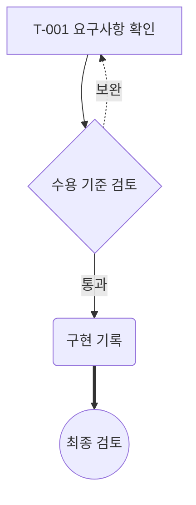

# Phase4의 제한된 Mermaid 표시 계약

기록일: 2026-10-09

## 수용 범위

Phase4는 **Mermaid 전체 호환 렌더러가 아니다**. Mermaid 런타임을 설치하거나 실행하지 않고, 아래의 제한된 `flowchart`/`graph` 문법만 자체 파서로 읽어 고정된 Vue SVG 요소로 표시한다. Markdown의 `mermaid` 코드 펜스에 적용된다. 문서의 링크, 스크립트, 명령, 모델, 외부 이미지 요청은 실행하지 않는다.

문법을 지원하지 않거나 제한을 넘으면 **해당 도식 전체를 안전한 원문으로 표시**한다. 지원하지 않는 줄을 버리고 남은 그래프를 성공처럼 보여 주지 않는다. Markdown 문서 자체의 전체 원문 보기 역시 유지한다.

## 정확한 지원 문법

- 헤더: `flowchart TD`, `flowchart TB`, `flowchart BT`, `flowchart LR`, `flowchart RL`; 같은 방향의 `graph` 헤더도 지원
- 문장 구분: 줄바꿈, 레이블·따옴표 밖의 세미콜론
- 노드 ID: 영문자 또는 `_`로 시작하는 최대 64자 식별자. 뒤에는 영문자·숫자·밑줄·일반 하이픈을 사용하며 화살표 문자의 연속과 혼동되는 ID는 지원하지 않음
- 기본 노드: `A`, `A[사각형]`, `A(둥근 사각형)`, `A{판단}`, `A((원형 계열))`
- 위 노드 안의 큰따옴표 텍스트 레이블: `T-001["T-001 요구사항 확인"]`
- 연결: `A --> B`, `A --- B`, `A -.-> B`, `A ==> B`
- 위 연결 뒤 파이프 레이블: `A -->|수용 기준 통과| B`, `A -.->|참고| B`
- 연결 체인: `A --> B --> C`
- 공백 없는 기본 연결: `A-->B`
- 독립된 노드, 여러 입력·출력, 순환 연결, 자기 자신으로 돌아오는 연결
- 그룹: `subgraph Group[그룹 이름]`, `subgraph Group["그룹 이름"]`, `subgraph "그룹 이름"`, `subgraph 그룹 이름`과 대응하는 `end`. 최대 4단계 중첩 그룹
- 그룹 경계·레이블과 그룹 간 노드 연결을 표시. 노드는 최초 선언된 그룹에 속하며 그룹 자체를 화살표 대상으로 지정하는 문법은 미지원
- `classDef`와 `class`: 아래의 제한된 문법을 읽고 **분류 이름만 노드 텍스트로 표시**. 원문의 색상·CSS는 적용하지 않으며 UI에서 이를 명시
- 독립된 `%%` 일반 주석 줄
- 한글 등 유니코드 레이블은 텍스트로 표시. 레이블 안 ` `, ` `, ` ` 토큰만 일반 줄바꿈 문자로 바꿈. HTML 파싱은 하지 않으며 나머지 HTML, HTML entity, Markdown-in-label, `\n` 이스케이프 등을 해석하지 않음

도식 배치는 제한된 자체 격자/계층 배치다. 그룹은 실제 소속 노드·하위 그룹만 감싸도록 별도 패널로 배치하며 그룹 간 연결은 원래 노드에 연결한다. 방향과 노드·연결을 보존하지만 Mermaid의 정확한 레이아웃이나 도형 비율과 동일하다고 주장하지 않는다. 원형 계열은 레이블 크기에 맞춘 타원형으로 표시한다. 긴 레이블은 자체 줄바꿈하며 전체 레이블과 원문을 유지한다.

아래 예시는 공개용 합성 데이터다.

### 분류 문법과 명시적인 스타일 생략

- `classDef ready fill:#eef,color:#112233`
- `classDef ready,review stroke:gray,stroke-width:2px`
- `class T-001,T-002 ready`; 여러 분류 이름은 쉼표로 구분
- 노드와 분류 이름은 최대 64자 영문 식별자이며 분류는 최대 32개
- 분류 지정은 앞뒤 선언 순서와 무관하지만 최종적으로 실제 노드와 분류 선언이 존재해야 함
- 읽을 수 있는 속성 이름: `fill`, `stroke`, `color`, `stroke-width`, `stroke-dasharray`, `opacity`, `font-size`, `font-weight`, `font-style`, `fill-opacity`, `stroke-opacity`
- 값은 제한된 hex 색상, 영문 단어 또는 숫자/길이 토큰만 허용. URL, 함수 호출, 따옴표·중괄호, 다른 속성은 원문 대체
- 위 문법을 통과해도 **그 CSS를 SVG·DOM에 적용하지 않음**. 클래스 이름을 `분류: ready` 같은 텍스트로 표시하고, 색상·서식을 생략했다는 안내 및 전체 원문을 제공
- 원문 색상만으로 표현한 상태·중요도를 앱이 같은 의미로 복원했다고 주장하지 않음

## 전체 원문으로 대체하는 문법

다음은 대표적인 미지원 문법이며, 위 지원 목록 밖의 문법도 동일하게 원문으로 표시한다.

- `erDiagram`, `sequenceDiagram`, `stateDiagram`, `classDiagram`, Gantt, pie 등의 다른 도식 종류
- 그룹별 `direction`, 그룹 ID를 화살표 대상으로 쓰는 연결, 닫히지 않거나 잘못 중첩된 그룹
- 위 문법 밖의 `classDef`/`class`, `style`, `linkStyle`, `:::className` 등 인라인 스타일·클래스 적용
- `click`, 콜백, 링크, 툴팁 동작, 외부 이미지·아이콘·새 노드 메타데이터 문법
- `%%{init: ...}%%` 등 설정 지시문
- `A & B --> C`, `A --> B & C` 등 다중 노드 축약
- `A -- 설명 --> B`, `A -. 설명 .-> B`, 다른 화살촉·연결 연산자. 파이프 레이블 형태만 지원
- 여러 줄 노드 문자열, 레이블의 이스케이프 따옴표, 노드 모양을 혼동시키는 중첩 괄호, 같은 ID에 서로 다른 명시적 레이블을 반복하는 선언
- 노드 레이블 외 임의 HTML·CSS·실행 가능한 콘텐츠

` ` 계열 토큰만 정규식으로 일반 줄바꿈 문자로 바꾸며 DOM 요소를 생성하지 않는다. 그 외 HTML 모양의 문자열은 **글자 그대로** 표시한다. 외부 리소스가 있는 HTML 모양의 레이블도 요청을 일으키지 않는다.

## 한도와 실패 표시

- 도식 원문: 최대 65,536 JavaScript 문자열 문자(UTF-16 코드 단위)
- 문장: 최대 512개
- 노드: 최대 64개
- 연결: 최대 128개
- 그룹: 최대 16개, 중첩 4단계
- 분류 선언: 최대 32개
- 개별 레이블: 최대 256 UTF-16 코드 단위
- 도식이 한도를 초과하거나 해석에 실패하면 이유와 가능할 때 줄 번호를 표시하고 전체 도식 원문을 펼쳐 표시
- 정상 렌더링에도 접을 수 있는 `Mermaid 원문`을 제공
- 찾기 쿼리가 있으면 도식 원문을 펼쳐 문서 찾기의 결과를 확인할 수 있게 함
- 문서 전체 읽기 한도(UTF-8 8 MiB), Markdown 파싱 예산, 읽기 권한 검사는 별개이며 더 앞 단계의 거절은 해당 이유를 표시

SVG의 요소명·속성명·스타일은 앱이 고정한다. 입력 레이블은 Vue 텍스트 자식만 사용한다. `innerHTML`, `v-html`, Mermaid 실행기, SVG `foreignObject`, 소스에서 지정한 URL 속성 또는 이벤트 속성은 사용하지 않는다.

## 실제 표본과의 차이

2026-10-09 읽기 전용 사전 조사에서 보관한 **문법 메타데이터**에는 `flowchart LR`, `flowchart TD`, `erDiagram`이 있었다. 이 기록은 저장소 전체 Mermaid 호환성 조사나 완전 지원 증명이 아니다.

- 추가로 확인한 두 DAG 표본의 Mermaid 3개 블록에는 모두 `classDef`와 `class`가 있었다
- 그중 2개 블록에는 `subgraph`가 있었고, 2개에는 HTML 줄바꿈 모양의 레이블이 있었다
- 최초의 기본 흐름도 구현은 이 3개 블록을 모두 원문으로 대체했다. 확인 후 그룹·분류 텍스트·일반 줄바꿈 처리를 추가했다
- **확장 후 이 DAG 표본의 3개 블록은 읽기 전용 파서 확인을 모두 통과했다**. 각각 노드/연결/그룹 수는 3/0/0, 4/3/1, 19/19/3이었다. 모두 `styles-omitted` 안내가 있으므로 원문 색상 재현까지 통과했다는 의미는 아님
- 실제 비공개 문서를 UI 스크린샷·테스트 산출물로 복제하지 않았다. 동일한 구조 규모의 합성 19태스크/19연결/3그룹 사례를 자동 테스트로 검증한다
- 다른 문서 목록에서 관측한 ER 도식은 원문으로 대체된다
- 추가 TD/LR 도식 4개의 헤더·길이 메타데이터만으로 그 도식 전체가 호환된다고 판단하지 않았다
- Mermaid가 없는 일반 요구사항·태스크 문서에는 이 제한이 적용될 도식이 없다

이 문서는 비공개 원문의 파일명, 레이블, 본문 또는 실제 업무 관계를 복제하지 않는다. 자동화 테스트도 합성 레이블·관계만 사용한다. 제품 UI는 `제한된 Mermaid 흐름도`라고 명시하고, 단순화한 배치·클래스 색상/서식 생략·ER 등의 원문 대체를 안내한다.

## 검증과 판정

`tests/unit/phase4-safe-documents.test.ts`에서 다음을 별도로 확인한다.

1. TD/LR 합성 태스크 흐름, 형태·화살표·연결 레이블·점선·순환·그룹·중첩 그룹의 안전한 데이터와 SVG 생성
2. 관측한 문법을 모사한 합성 subgraph/classDef/class 도식의 노드·연결·그룹 소속 보존, 스타일 생략 안내; ER 도식의 전체 원문 보존
3. 미지원 점선 레이블 표현, 다중 노드 축약, 설정 지시문·클릭·스타일의 명시적 실패
4. HTML 모양 레이블의 이스케이프와 URL·이벤트·실행 요소 부재
5. 원문·노드·연결·그룹·중첩·분류 한도와 완전한 원문 대체

따라서 현 단계의 수용 판정은 **제한된 흐름도·그룹 표시 + 분류 이름의 텍스트 보존 + 미지원 도식의 완전한 안전 원문 열람**이다. Mermaid와 동일한 배치, 원문 클래스 색상·서식의 재현, ER 도식의 시각화는 완료 판정에 포함하지 않는다. 그 시각화가 필수라면 안전한 지원 문법을 확장한 뒤 별도 테스트와 실제 표본 호환성 판정이 필요하다.
